# AtmosFX

**Physically based skies, stars, moon, clouds and fog for Blender** - part of [OpenSimFX](https://github.com/opensimfx),
alongside BlastFX, RainFX and FlowFX.

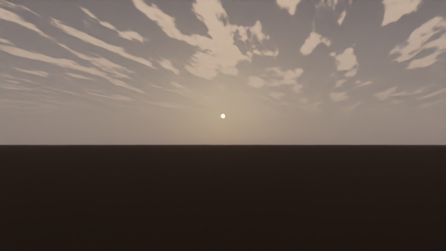

AtmosFX builds a complete atmosphere in one click: a Nishita sky driven by a real sun position, a star field with
recognisable constellations, a Milky Way, a moon with correct phase and lit limb, volumetric cloud layers, a cheap 2D
cirrus deck, and fog or haze whose density comes from a meteorological visibility. The sun, moon and stars follow a
real **place, date and time** (or you place them by hand), and every number the add-on computes is derived from
documented physics you can read in [docs/PHYSICS.md](docs/PHYSICS.md).

| | |
|---|---|
| 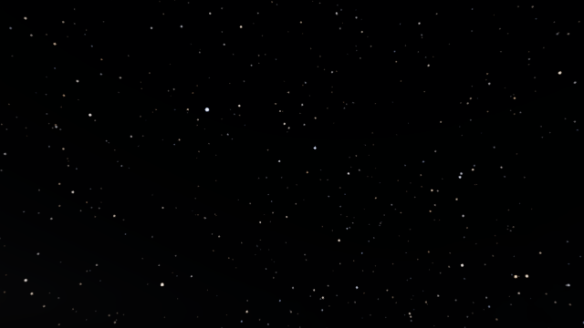 | 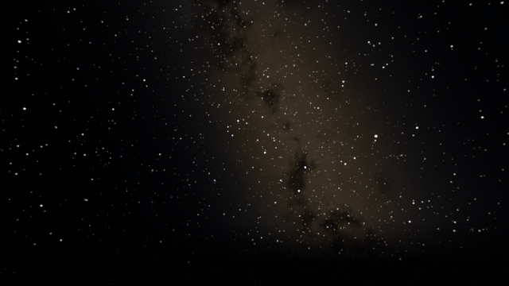 |
| 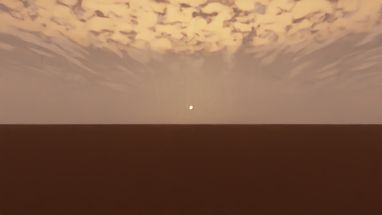 |  |

### More environments

| | | |
|---|---|---|
| 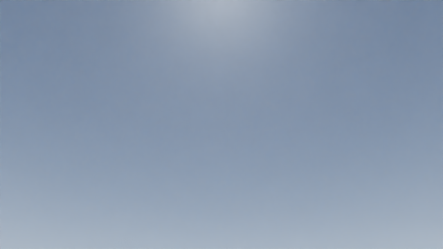 | 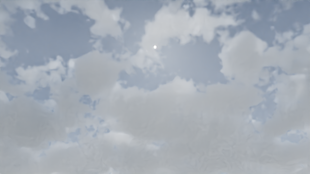 | 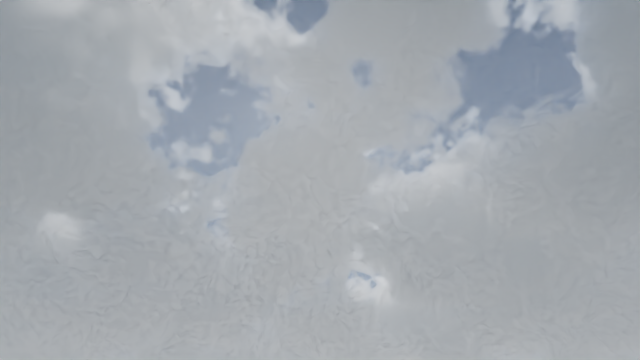 |
| 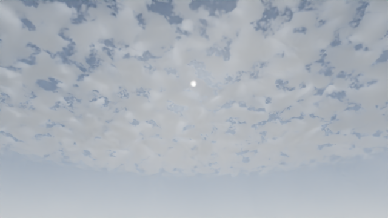 | 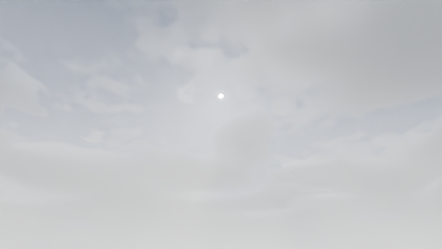 |  |
| 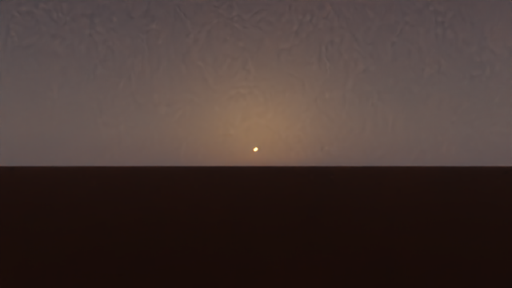 | 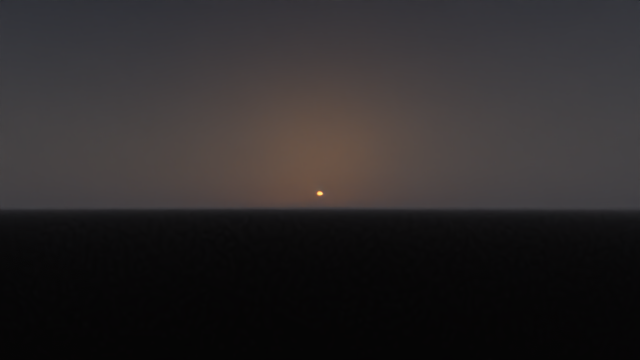 | 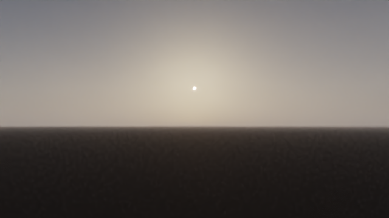 |
| 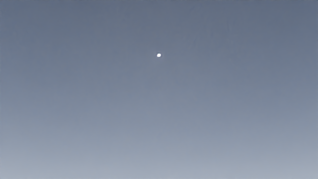 | 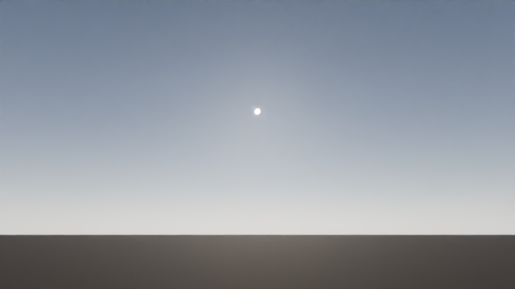 | 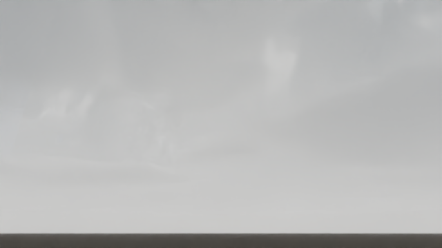 |
| 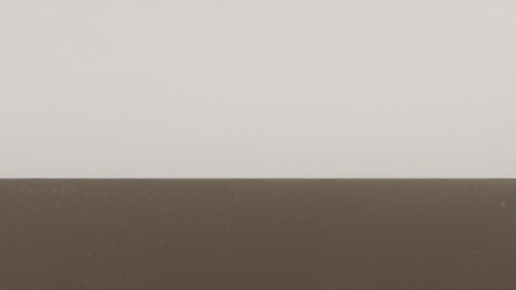 | 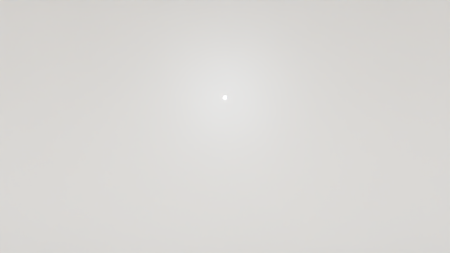 | 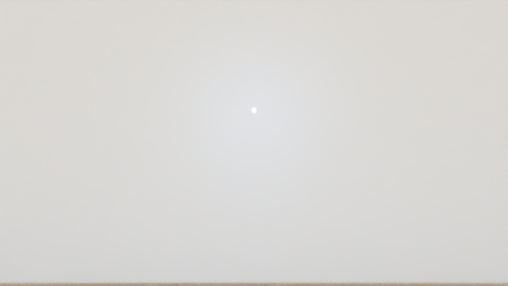 |

_Renders: headless Cycles on one CPU core, 12 samples, OpenImageDenoise, ACES preview tone-map
(`tools/render_preview.py`). They are look-dev checks, not showpieces._

## Features

- **Sky**: Blender's multiple-scattering Nishita sky; air, aerosol and ozone density; viewpoint altitude; below-horizon
  ground; sun disc with limb darkening at physical radiance.
- **Earth mode**: sun, moon and stars from latitude, longitude, date, local time and UTC offset (Meeus ephemeris,
  refraction, precession). Sunrise/sunset readout. Animate the clock with the timeline.
- **Artistic mode**: place sun and moon by elevation and azimuth; moon phase slider.
- **Stars**: 119 real bright stars at J2000 positions plus ~9000 synthetic faint stars following the observed
  magnitude law, thresholded by a limiting magnitude that twilight, moonlight and cloud lower automatically.
- **Milky Way**: galactic-frame procedural band with dust lanes and a warm bulge.
- **Moon**: phase from the true Sun-Earth-Moon geometry, procedural maria, moonlit sky glow, moon lamp.
- **Clouds**: up to three volumetric layers (cumulus, stratocumulus, stratus, altocumulus, altostratus,
  cumulonimbus, cirrus) with coverage that equals filled area, wind advected by scene time, a **separate cloud sun**
  (light-linked) attenuated at cloud height so clouds can glow while the ground is already dim, and a
  **multiple-scatter fill** with bright tops, warm undersides at low sun and a backlit forward-scatter halo.
- **2D cloud deck**: infinite cirrus/altostratus in the world shader; free to render; no shadows; warms with a low sun.
- **Fog and haze**: visibility in metres (Koschmieder), exponential height falloff, patchiness, absorption (smog),
  as a camera-following haze dome and/or a placeable fog bank.
- **28 presets** in five categories ([docs/PRESETS.md](docs/PRESETS.md)); export/import your own as JSON.
- **Quality tiers** that configure Cycles and EEVEE volume settings for you.

## Install

Requires Blender **5.0 or newer** (verified on 5.0.1 and 5.2.1 LTS, see below).

```bash
python tools/build_extension.py        # -> dist/atmosfx-0.1.0.zip
```

In Blender: *Edit > Preferences > Get Extensions > (v) > Install from Disk...*, pick the zip. The panel appears in
the 3D Viewport sidebar (**N**) under **AtmosFX**.

## Quick start

1. Open the **AtmosFX** tab, pick a preset, press **Add Atmosphere**.
2. Raise the camera's **Clip End** above your cloud/haze radius (the panel warns you and has a one-click fix).
3. Open **Time and Place**, switch to **Earth**, enter latitude/longitude/date/time.
4. Render with Cycles. Use **Draft** while composing and **Final** for the frame.

A scripted version is in [examples/quickstart.py](examples/quickstart.py). Full walkthrough:
[docs/USER_GUIDE.md](docs/USER_GUIDE.md).

## Verification status (read this)

Verified on **Blender 5.0.1 and 5.2.1 LTS (`bpy` wheels), macOS arm64**:

- 102 pure-Python unit tests: ephemeris against Meeus worked examples, photometry, star catalogue separations,
  cloud mapping, multiple-scatter lighting, preset schema, derived sky values.
- 23 headless Blender checks, 4 of them renders: stars land within 0.3 degrees of their computed positions (measured
  0.05-0.08), the sun disc within 0.1 degree, a rendered cloud slice fills the area the coverage setting promises,
  haze keeps the sky visible, and every cloud material receives the derived multiple-scatter colours. The same 23
  checks pass on 5.0.1 and 5.2.1; Cycles CPU was also checked on Linux at 0.1. Install-as-extension from the built zip
  registers and runs on both versions.
- 4 opt-in EEVEE render checks: clear sky, sunset clouds, dense fog and a star field all render non-black on both
  versions, and the night sky contains bright star pixels. Volume quality is coarser than Cycles.

**Not verified** - treat as unknown:

- Blender versions other than 5.0.1 and 5.2.1; Windows; GPU Cycles; EEVEE on CI or a machine without a GPU/display
  (the EEVEE checks are opt-in for this reason).
- The panels were never drawn in an interactive Blender session; only their operators and properties were exercised.
- Cloud *appearance* is display-calibrated look-dev, not a reference match: the multiple-scatter fill gives bright
  tops and warm low-sun undersides, but thick clouds still look flatter than real ones and the term double counts a
  little single scattering. Cloud render cost is high (minutes per frame on one CPU core at 640x360).
- Absolute brightness constants (sun 3.0, moon 0.12, star gain, Milky Way) are calibrated by eye for AgX/Filmic at
  0 EV, not measured.
- The star catalogue was entered by hand from published values and checked only by known angular separations, not
  against a machine-readable catalogue.

## Repository layout

```
atmosfx/                 the add-on (this folder is what the extension zip contains)
  core/                  pure Python, no bpy: physics, astro, stars, clouds, presets, skyview
  nodes/                 node-group builders (sky, cloud, fog)
  scene/                 world, lamps, domain objects, render settings, orchestration
  ui/                    properties, operators, panels, preset conversion
  data/presets.json      the shipped preset library (generated)
docs/                    system design, physics, user guide, presets, roadmap, references, testing
tests/                   pytest suites + headless Blender checks
tools/                   build_extension, gen_presets, gen_preset_docs, render_preview
examples/                scripts that build a scene from the command line
```

## Develop

```bash
python -m pytest                          # pure tests (numpy needed for the star baker tests)
# bpy: Python 3.11 for 5.0.1; Python 3.13 for 5.2.1 (download.blender.org/pypi)
python tests/blender_smoke.py             # needs bpy: 19 checks, ~20 s
ATMOSFX_RENDER_TESTS=1 python tests/blender_smoke.py   # + 4 Cycles render checks, ~1 min
ATMOSFX_EEVEE_TESTS=1 python tests/blender_smoke.py    # + 4 EEVEE render checks, needs a GPU/display
python tools/gen_presets.py               # regenerate data/presets.json from the table in the tool
python tools/render_preview.py golden_hour --out docs/img --width 640 --samples 12   # README gallery
```

## Documentation

[System design](docs/SYSTEM_DESIGN.md) - [Physics](docs/PHYSICS.md) - [User guide](docs/USER_GUIDE.md) -
[Presets](docs/PRESETS.md) - [Testing](docs/TESTING.md) - [Roadmap](docs/ROADMAP.md) -
[References and licensing](docs/REFERENCES.md) - [Changelog](CHANGELOG.md)

## License

GPL-3.0-or-later. AtmosFX contains no code, shaders, textures or data from the commercial products that informed its
feature list; see [docs/REFERENCES.md](docs/REFERENCES.md).
